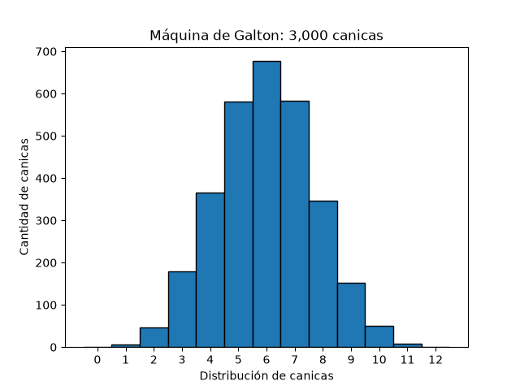

# Simulación de una Máquina de Galton en Python

Proyecto final del módulo **Fundamentos de Python** (Ucamp).
Simula 3,000 canicas cayendo por una Máquina de Galton y muestra el resultado en un histograma.

## ¿Qué es la Máquina de Galton?

Es un tablero con filas de obstáculos (clavos). Una canica que cae choca con un obstáculo en cada nivel y se desvía a la izquierda o a la derecha con la misma probabilidad. Al final cae en uno de varios contenedores.

## Lógica de la simulación

1. **Una canica:** `simular_canica(niveles=12)` recorre 12 niveles. En cada uno decide al azar (`random.choice`) entre izquierda o derecha. Cada vez que va a la derecha, suma 1 a su contenedor. El resultado es un entero entre 0 y 12.
2. **Muchas canicas:** `simular_canicas(cantidad=3000)` repite el proceso 3,000 veces y guarda cada contenedor final en una lista.
3. **Gráfica:** `graficar_resultados(datos)` crea un histograma con `matplotlib`, con título y nombres en los ejes.

### ¿Por qué sale forma de campana?

Hay muchas más combinaciones de caminos que llevan a los contenedores centrales (por ejemplo, 6 derechas y 6 izquierdas en cualquier orden) que a los extremos (solo una forma de caer en el 0: 12 izquierdas seguidas). Por eso la mayoría de canicas termina cerca del centro. No se usó `normal()`: la forma aparece sola a partir de pasos aleatorios.

## Resultado



## Cómo ejecutarlo

Requisitos: Python 3 y matplotlib.

```bash
pip install matplotlib
python NOMBRE_APELLIDO_proyectoM3.py
```

El programa abre una ventana con el histograma y guarda la imagen como `histograma.png`.

## Estructura del repositorio

```
.
├── NOMBRE_APELLIDO_proyectoM3.py   # código del proyecto
├── histograma.png                  # imagen del resultado
└── README.md                       # este archivo
```

## Reflexión sobre funciones y módulos

**Funciones:** dividir el programa en tres funciones (`simular_canica`, `simular_canicas` y `graficar_resultados`) hizo el código más claro y fácil de probar. Cada una hace una sola tarea y se puede reutilizar: por ejemplo, `simular_canica` sirve igual para 1 canica o para 3,000. Los parámetros con valor por defecto (`niveles=12`, `cantidad=3000`) permiten cambiar la simulación sin reescribir código, y los valores de retorno conectan las funciones entre sí.

**Módulos:** con `import random` y `import matplotlib.pyplot as plt` aproveché código ya hecho por otros en lugar de programar el azar o los gráficos desde cero. Aprendí que un módulo estándar viene con Python (`random`), mientras que un paquete externo como `matplotlib` hay que instalarlo.

**Aprendizaje general:** documentar con docstrings y comentarios hace que el código se entienda semanas después, y aplicar un problema real (la Máquina de Galton) ayudó a ver para qué sirven las funciones y los módulos.

## Autor

HAROLD GARZÓN
